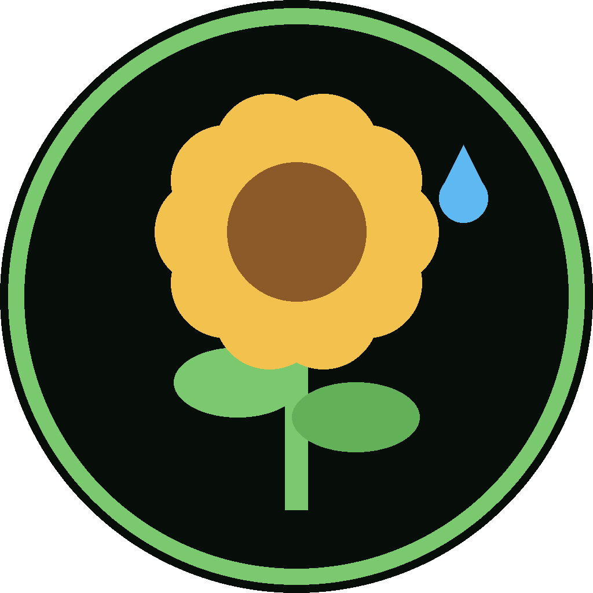

<p align="center"></p>

<h1 align="center">FLORA</h1>
<h3 align="center">Field Leaf Observer & Root Assistant</h3>
<p align="center"><i>The DREAM Robotics gardener</i></p>

<div align="center">

[](https://x.com/NorowaretaGemu) [](https://opensource.org/licenses/MIT)

</div>

<div align="center">
  <a href="https://ko-fi.com/cursedentertainment">
    
  </a>
</div>

<div align="center">
  
  
  
  
</div>

---

- Robot Type: Gardener (an ESP32 planted by a plant, with a pump)

<div align="center">
  
  <p><i>FLORA</i></p>
</div>

**Site:** [cursedprograms.github.io/FLORA-Robot-v00](https://cursedprograms.github.io/FLORA-Robot-v00/)

The fleet's gardener. FLORA feels the soil, the air and the light around one plant (or a bed), and waters it when it needs it, unless AURA, the weather station, says rain is on the way.

---

## What she does

- **The soil:** a soil fork tells her how moist it is, as a percentage you calibrate from her page ("this is dry", "this is wet"). The fork is powered only for the moment she reads it, once a minute: a resistive fork powered all the time corrodes away within weeks.
- **The air:** temperature and humidity from an AHT10, the same sensor and code as NORA and MILA. AURA plots them with the rest of the fleet, in FLORA's green.
- **The light:** a photoresistor module, like MILA's (as a brightness percentage, and the hours of good light the plant got today), and an analog UV module, like KIDA-01's (as a UV index).
- **Watering, safely:** automatic watering starts **off**: turn it on from her page once the fork is calibrated and the pump tested. Then she waters only when the soil is drier than your setting, and never:
  - for more than 10 seconds at a time (and the pump has a hard 15-second cut-off whatever happens),
  - within 30 minutes of the last watering (it needs time to soak in and be read again),
  - more than 4 times a day,
  - in the midday heat (11:00 to 15:00, unless the soil is critically dry),
  - when AURA thinks rain is coming, or Open-Meteo has rain within 3 hours,
  - when the fork reads nonsense (a loose wire reads flat 0 or 100 %).

  The drier the soil, the longer she waters, up to the limit. Every number is a setting on her page. **Water now** (5 seconds) and **Stop** are there too; anything that changes something asks for the fleet PIN.
- **The fleet:** she joins the highest fleet network she can see (the ladder: she never hosts one), registers with whoever hosts the fleet list (`garden, climate, web:5018, talk:5018, do:water, do:stop`), beacons over ESP-NOW and Bluetooth LE (so RITA shows how far she is), serves her whole web API over Bluetooth serial too, and beeps the fleet's Brainfuck phrases on her buzzer in RIFT's conversations. RIFT's Ask & tell can tell her to water (it asks a person first) or stop.
- **The time:** from the internet (NTP), in AURA's time zone, so "midday" is your midday.

## Wiring (ESP32 DevKit)

| Part | Pin |
|---|---|
| Soil fork (YL-69) AO | GPIO34 |
| Soil fork VCC | GPIO25 (powered only while reading) |
| Soil fork GND | GND |
| AHT10 SDA / SCL | GPIO21 / GPIO22 (VIN 3.3 V) |
| Photoresistor module AO | GPIO35 (VCC 3.3 V) |
| UV module (GUVA-S12SD) OUT | GPIO32 (VCC 3.3 V) |
| Relay IN (pump) | GPIO26: active LOW, like most relay modules |
| Buzzer | GPIO27 |
| LED | GPIO2 (on while watering, blinking when she's thirsty) |

The pump runs from its **own** 5 V supply through the relay's COM / NO contacts, never from the ESP32. Every analog sensor is on ADC1 (GPIO32-39), the half of the ESP32's analog inputs that still works while WiFi is on.

## Quick start

1. Copy `scripts/esp32/secrets.example.h` to `secrets.h` and fill in the fleet's WiFi passwords (or keep the fleet's own).
2. Run `flash.bat` (it installs the Arduino command line tool, the ESP32 core and ArduinoJson the first time), or flash `scripts/esp32/esp32.ino` as an **ESP32 Dev Module** with the **Huge APP (3MB No OTA)** partition scheme. Over the cable: there's no room for updates over WiFi.
3. Open her page: `http://<her address>:5018/` (FIND in her app or exe gets the address from the fleet list).
4. Calibrate the fork: in the air, **This is dry**; in a glass of water, **This is wet**. Push it into the soil.
5. Test the pump with **Water now**, then turn **Automatic** on.

## Apps

- **Windows:** [`builds/flora.exe`](builds/flora.exe): her page in a native window. Source: `scripts/web_controller` (`build.bat`, Visual Studio 2022).
- **Android:** `Android App/` (package `com.synthwomb.flora`), her page full screen. FIND gets her address from the fleet list. Install: [`FLORA-debug-2026-11-05.apk`](Android%20App/apk/FLORA-debug-2026-11-05.apk). Build it with `gradlew assembleDebug` (JDK 17).

## API (port 5018)

| Request | What it does |
|---|---|
| `GET /status` (or `/sensors`) | `soil` (%), `soil_raw`, `temp`, `hum`, `light`, `uv`, `light_hours_today`, `pump`, `auto`, `watered_today`, `last_water_min_ago`, `decision` (why she is or isn't watering), `rain_chance` (AURA's), `rules`, `calibration` |
| `GET /history` | Soil moisture every 15 minutes for the last 24 hours |
| `POST /water?pin=&s=5` | Water now (capped at the max seconds) |
| `GET /stop` | Stop the pump (always allowed) |
| `POST /auto?pin=&on=1` | Automatic watering on or off |
| `POST /calibrate?pin=&point=dry` | The fork's dry (or `wet`) reading, from what it reads now |
| `POST /rules?pin=&dry_at=30...` | Her settings: `dry_at`, `critical_at`, `max_seconds`, `min_gap_min`, `max_per_day`, `rain_skip_chance`, `quiet_from`, `quiet_to` |
| `POST /do` | `{"action": "water"}` or `{"action": "stop"}` (RIFT's Ask & tell) |
| `GET /chirp?u=0-16` | Beeps a phrase from the fleet's Brainfuck phrasebook |
| `GET /near` | Who's near her (ESP-NOW and Bluetooth LE) |

Over Bluetooth serial ("FLORA") every request works the same: `>GET /status`.

## Tests

The watering rules are plain C++ (`scripts/esp32/flora_rules.h`), tested on the PC:

```
cd tests
g++ -std=c++17 -I../scripts/esp32 test_rules.cpp -o test_rules && test_rules
```

Never when automatic is off or the fork reads nonsense, skip when AURA expects rain or rain is forecast soon, wait out the midday heat unless critically dry, the gap between waterings, the daily limit, the longest run, and the moisture maths.

## Files

```
scripts/esp32/esp32.ino        her firmware
scripts/esp32/flora_rules.h    when she waters (tested on the PC)
scripts/esp32/web/             her page (index.html, style.css, app.js) -> web_page.h (scripts/make_web.py)
scripts/esp32/fleet_*.h        the fleet's beacons and Bluetooth link (RIFT/Fleet/esp32, NORA)
scripts/esp32/talk_bf.h        the Brainfuck phrasebook (RIFT/Fleet/brainfuck_talk.py)
scripts/flash.ps1, flash.bat   compile and flash
scripts/web_controller/        builds/flora.exe
Android App/                   the Android app
tests/test_rules.cpp           the watering rules on the PC
index.html, site/              the GitHub Pages site
```

Her colours: soil green (`#070D09`), leaf green (`#7BC96F`), sunflower yellow (`#F2C14E`) and water blue (`#5EB8F2`).

---

<!-- DREAM-ECOSYSTEM:START -->

---

<div align="center">&copy; Cursed Entertainment 2026</div>

<div align="center">
  <a href="https://cursed-entertainment.itch.io/">
    
  </a>
</div>

---

## The DREAM Robotics ecosystem

**Minds** — [DREAM](https://github.com/CursedPrograms/DREAM) companion · [TINA](https://github.com/CursedPrograms/TINA) engineer · [NINA](https://github.com/CursedPrograms/NINA) caretaker · [RIFT](https://github.com/CursedPrograms/RIFT) fleet hub · [LYCEA](https://github.com/CursedPrograms/LYCEA) training school  
**Robots** — [NORA](https://github.com/CursedPrograms/NORA-Robot-v00) · [MILA](https://github.com/CursedPrograms/MILA-Robot-v00) · [WHIP](https://github.com/CursedPrograms/WHIP-Robot-v00) · [KIDA-00](https://github.com/CursedPrograms/KIDA-Robot-v00) · [KIDA-01](https://github.com/CursedPrograms/KIDA-Robot-v01) · [IDA](https://github.com/CursedPrograms/IDA-Robot-v00) · [ARM](https://github.com/CursedPrograms/ARM-Robot-v01) · [NIKA](https://github.com/CursedPrograms/NIKA-Robot-v00) · [ARIA](https://github.com/CursedPrograms/ARIA-Robot-v00) · [AURA](https://github.com/CursedPrograms/AURA) weather · [FLORA](https://github.com/CursedPrograms/FLORA-Robot-v00) gardener  
**Remotes** — [RITA](https://github.com/CursedPrograms/RITA) handheld remote  
<!-- DREAM-ECOSYSTEM:END -->
